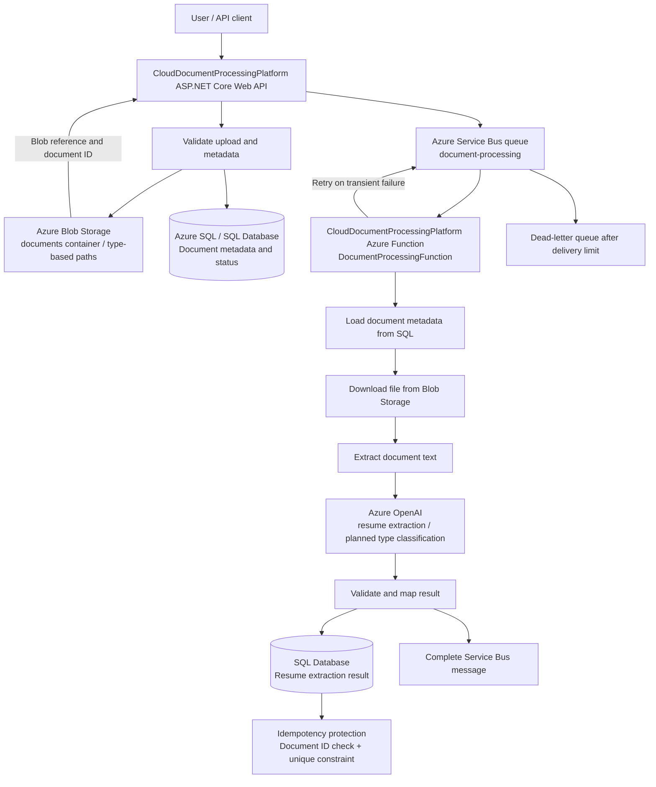

# CloudDocumentProcessingPlatform -- Intelligent Document Processing Platform

CloudDocumentProcessingPlatform is a personal Azure learning project that demonstrates an
asynchronous document-processing pipeline using ASP.NET Core, Azure Blob
Storage, Azure Service Bus, Azure Functions, Azure OpenAI, and SQL.

> **Project status:** The core upload-to-processing flow and Service Bus
> reliability work are implemented and tested. AI-based document-type
> classification and the Angular UI are planned enhancements unless
> explicitly implemented in the current branch.

## Contents

-   [Overview](#overview)
-   [Architecture](#architecture)
-   [Document-processing flow](#document-processing-flow)
-   [Technology stack](#technology-stack)
-   [Reliability and duplicate
    protection](#reliability-and-duplicate-protection)
-   [Security](#security)
-   [Repository structure](#repository-structure)
-   [Configuration](#configuration)
-   [Run locally](#run-locally)
-   [Testing ideas](#testing-ideas)
-   [Roadmap](#roadmap)

## Overview

CloudDocumentProcessingPlatform accepts a document, stores the original file in Azure Blob
Storage, records its metadata in SQL, and publishes a message to Azure
Service Bus. An Azure Function consumes the message, retrieves the
document, extracts/processes its content, and saves the processing
result to SQL.

The current resume-processing path stores the extracted resume result in
the `Resume` table. The application uses a `DocumentType` enum for
supported document types.

## Architecture

The diagram below reflects the current known processing flow. AI-based
automatic document classification is shown as a planned extension, not
as a completed production capability.



A separate editable Mermaid source is provided as `architecture.mmd`.
GitHub can render Mermaid diagrams in Markdown files; you can also paste
the source into a Mermaid-compatible editor.

## Document-processing flow

1.  The API receives a file and validates the request.
2.  The API uploads the original file to Blob Storage.
3.  The API saves document metadata and its processing status in SQL.
4.  The API sends a Service Bus message containing the document
    identifier and the information needed to locate the blob.
5.  `DocumentProcessingFunction` receives the message and looks up the
    document record.
6.  The Function downloads the file and extracts its text.
7.  The processing service extracts resume information using the
    configured Azure OpenAI deployment.
8.  The Function saves the result to SQL and completes the Service Bus
    message.
9.  If processing fails, the message can be retried. Messages that
    exceed the queue's delivery limit can be moved to the dead-letter
    queue.

The exact order of database updates and message completion should be
kept consistent with the implementation in the current source branch.

## Technology stack

  -----------------------------------------------------------------------
  Area                                Technology
  ----------------------------------- -----------------------------------
  API                                 C#, ASP.NET Core Web API

  Dependency management               Built-in .NET dependency injection

  File storage                        Azure Blob Storage

  Asynchronous messaging              Azure Service Bus

  Background processing               Azure Functions

  AI extraction                       Azure OpenAI

  Data persistence                    SQL / Azure SQL

  Secrets and identity                Azure Key Vault and Managed
                                      Identity where configured

  Observability                       `ILogger`; Application Insights can
                                      be used for hosted telemetry

  API exploration                     Swagger / OpenAPI
  -----------------------------------------------------------------------

## Reliability and duplicate protection

The current Service Bus configuration and processing safeguards include:

-   **Sender retries:** Exponential retry policy with up to 3 retries, a
    1-second initial delay, and a 5-second maximum delay.
-   **Queue delivery limit:** `MaxDeliveryCount = 5`.
-   **Message time-to-live:** 1 day (`86,400,000` milliseconds).
-   **Dead-lettering:** Messages that exceed the delivery limit can be
    inspected in the dead-letter queue.
-   **Manual message completion:** The Function uses
    `AutoCompleteMessages = false` and completes a message after
    successful processing.
-   **Idempotency:** The processing flow checks whether a resume result
    already exists for the document.
-   **Database protection:** A unique SQL constraint named
    `UQ_Resume_DocumentId` prevents duplicate resume results for the
    same document.

These controls reduce duplicate writes and help recover from transient
failures. They do not remove the need to monitor and investigate
dead-lettered messages.

## Security

-   Keep API keys, connection strings, and other secrets out of source
    control.
-   Use local User Secrets for development and Key Vault / Managed
    Identity for deployed workloads where configured.
-   Apply least-privilege access to Blob Storage, Service Bus, Key
    Vault, and SQL.
-   Validate uploaded file size, extension, content type, and actual
    file format.
-   Avoid logging document contents, access tokens, API keys, or other
    sensitive data.
-   Treat uploaded document text as untrusted input when sending it to
    an AI model.
-   Do not expose Azure OpenAI credentials in a client-side Angular
    application.

## Repository structure

The following is a conceptual structure; adapt names to match the actual
repository.

``` text
CloudDocumentProcessingPlatform/
├── CloudDocumentProcessingPlatform.API/
│   ├── Controllers/
│   ├── Models/
│   ├── Repository/
│   └── Services/
├── CloudDocumentProcessingPlatform.Functions/
│   └── DocumentProcessingFunction
├── README.md
├── architecture.mmd
└── architecture.svg
```

## Configuration

Use configuration providers appropriate to the environment. Do not
commit real values.

Typical settings include:

-   Azure Blob Storage endpoint or connection configuration
-   Azure Service Bus namespace and queue name (`document-processing`)
-   SQL connection configuration
-   Azure OpenAI endpoint and deployment name
-   Key Vault / Managed Identity settings for deployed environments

Use placeholder values in local configuration templates, and store
actual secrets outside the repository.

## Run locally

The exact commands depend on the solution and project filenames in your
checkout.

1.  Install the .NET SDK version required by the solution.

2.  Configure local development settings using User Secrets or an
    untracked local settings file.

3.  Ensure the required Azure resources are available, or configure
    local emulators where supported.

4.  Restore dependencies:

    ``` bash
    dotnet restore
    ```

5.  Start the API project:

    ``` bash
    dotnet run --project <path-to-CloudDocumentProcessingPlatform.API.csproj>
    ```

6.  Start the Azure Functions project using the local Functions tooling:

    ``` bash
    func start
    ```

7.  Upload a test document through Swagger or your API client, then
    verify the metadata, Service Bus message, Function logs, and SQL
    processing result.

Replace the placeholder project path with the actual `.csproj` path in
your repository.

## Testing ideas

-   Upload a valid PDF and confirm that the blob and metadata are
    created.
-   Send a message with a missing or invalid document ID and verify the
    expected failure behavior.
-   Simulate a transient dependency failure and confirm that retries
    occur.
-   Verify that repeated processing does not create duplicate resume
    records.
-   Verify that messages exceeding the delivery limit reach the
    dead-letter queue.
-   Test empty, corrupt, unsupported, oversized, and scanned documents.
-   Confirm that secrets and document contents are not written to logs.
-   For AI features, test valid known categories, unknown categories,
    malformed model responses, and low-confidence classifications.

## Roadmap

-   [ ] Add a general text-extraction layer for supported document
    formats.
-   [ ] Add AI-based document-type classification using the existing
    `DocumentType` enum.
-   [ ] Map unsupported categories to `Others` while preserving the
    detected label separately.
-   [ ] Add confidence handling and a review path for uncertain
    classifications.
-   [ ] Build the Angular upload and processing-status UI.
-   [ ] Add dashboards and alerts for Function failures and dead-letter
    queue growth.
-   [ ] Add automated tests for extraction, classification, retries, and
    idempotency.

## AI document classification design

When implemented, the classifier should receive extracted text and the
supported names from the C# enum. It should return a validated enum
name. If the response is not a valid enum value, the application should
safely fall back to `DocumentType.Others` (assuming that member exists).
Keep the model's detected label separate from the application's
supported type so a document such as `Bank Statement` can be routed to
`Others` without losing the more specific label.
